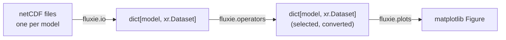

# How fluxie works

A fluxie analysis always follows the same three steps:



## 1. Reading: one dataset per model

Each model run is stored in netCDF files following a common template
(see [Input data format](data_format.md)).
[`read_model_output`][fluxie.io.read_model_output] reads the files of several
model runs and returns a **dictionary of [xarray](https://docs.xarray.dev) datasets**,
whose keys are the model run names:

```python
ds_all = read_model_output(data_dir, "flux", "hfc134a", models, config_data)
ds_all["InTEM_NAME_EUROPE_EDGAR"]  # an xr.Dataset
```

Because all models share the same variable names and dimensions, every function
in fluxie can handle any number of models in the same way.

There are three types of data (`file_type`):

| Type | Content |
|:--|:--|
| `flux` | Gridded and country fluxes (prior and posterior), with uncertainties |
| `concentration` | Observed and modelled mole fractions at the measurement sites |
| `eddy_flux` | Fluxes measured by eddy covariance, and the corresponding inventory fluxes |

## 2. Processing: operators

The [operators](../api/operators.md) take a dictionary of datasets and return a new
one. They are used to prepare the data before plotting, for example:

- [`slice_flux`][fluxie.operators.select.slice_flux] and
  [`slice_mf`][fluxie.operators.select.slice_mf] select a period (and a site) and
  convert the units,
- [`scale_by_sector_proportions`][fluxie.operators.flux_scale_by_sector_proportions.scale_by_sector_proportions]
  splits the total fluxes into sectors,
- [`stats_mf`][fluxie.operators.mf.stats_mf] computes statistics of the modelled
  versus observed mole fractions.

## 3. Plotting: one function per plot

Each [plot function](../api/plots.md) takes the dictionary of datasets and options,
and returns a matplotlib figure that you can further customize or save:

```python
fig = plot_flux_map(ds_all, species, region="EUROPE", config_data=config_data)
fig.savefig("flux_map.png")
```

All plot functions should give a good result with their default options,
and share the same argument names, for instance:

| Argument | Description |
|:--|:--|
| `ds_all` | Dictionary of model datasets |
| `species` | Name of the species, e.g. `"ch4"` |
| `config_data` | Content of the configuration files, from [`read_config_files`][fluxie.io.read_config_files] |
| `model_colors` | Colors of the models, from [`set_model_colors`][fluxie.config.set_model_colors] |
| `model_labels` | Labels of the models, from [`set_model_labels`][fluxie.config.set_model_labels] |
| `region` / `plot_regions` | Region(s) to plot, as defined in `regions_info.json` |

## Configuration

Information that does not depend on the model outputs (species properties,
regions, sites, model labels, sector groups) is stored in configuration files,
read with [`read_config_files`][fluxie.io.read_config_files].
fluxie comes with default configuration files in the `configs/` folder.
See [Configuration files](configuration.md).
